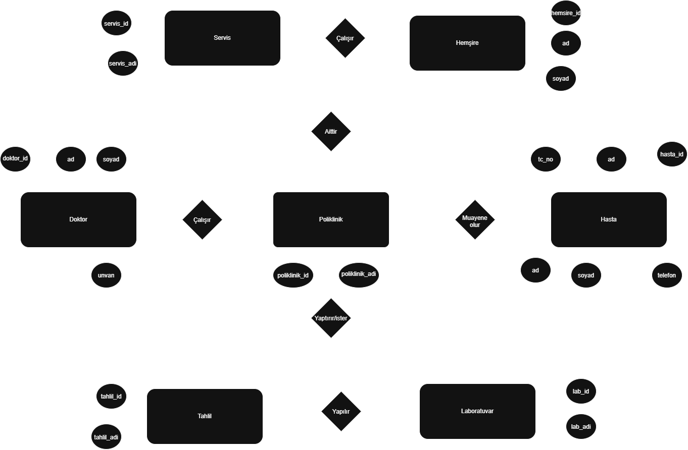

# Ders Sonu Ödevi - Hastane Otomasyonu

## ER Diyagramı

## Tablo Tasarımları

**1. Poliklinik**
- poliklinik_id (PK)
- poliklinik_adi

**2. Doktor**
- doktor_id (PK)
- ad
- soyad
- unvan
- poliklinik_id (FK)

**3. Servis**
- servis_id (PK)
- servis_adi
- poliklinik_id (FK)

**4. Hemsire**
- hemsire_id (PK)
- ad
- soyad
- servis_id (FK)

**5. Hasta**
- hasta_id (PK)
- tc_no
- ad
- soyad
- telefon

**6. Laboratuvar**
- lab_id (PK)
- lab_adi

**7. Tahlil**
- tahlil_id (PK)
- tahlil_adi
- lab_id (FK)

**8. Muayene (Hasta - Poliklinik N:M Ara Tablosu)**
- muayene_id (PK)
- hasta_id (FK)
- poliklinik_id (FK)
- muayene_tarihi

**9. Hasta_Tahlil (Hasta - Tahlil - Doktor N:M Ara Tablosu)**
- islem_id (PK)
- hasta_id (FK)
- tahlil_id (FK)
- doktor_id (FK)
- tahlil_tarihi
- sonuc